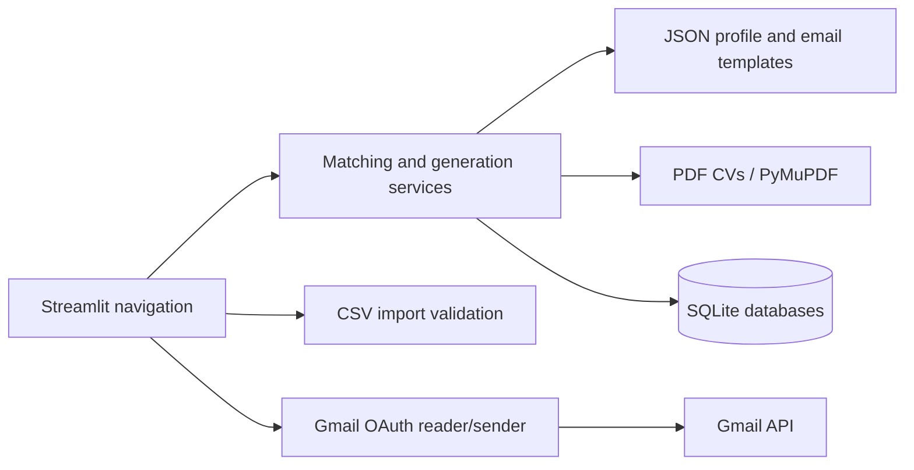

# PFE Copilot

PFE Copilot is a local Streamlit assistant for preparing and tracking final-year internship applications. It combines lexical job matching, profile-specific CV selection, editable French/English email drafts, motivation-letter PDF generation, CSV offer imports, optional Gmail OAuth, and SQLite tracking.

The matching engine is intentionally transparent: it normalizes the title and description, counts configured profile keywords from `config/profile.json`, and adds a small PFE signal. It is not TF-IDF, embeddings, or an AI ranking model.

## Implemented features

- Dashboard metrics and recent activity from SQLite.
- Job-offer analysis with detected profile, score, matched keywords, explanation, and CV recommendation.
- Four supported profiles: Data Engineer, Data Scientist, BI/Data Analyst, and AI Engineer.
- CV inventory, PDF validation, upload storage under `cvs/uploads/`, and PyMuPDF text extraction.
- Local French/English email templates with optional OpenAI-compatible generation when `OPENAI_API_KEY` is configured.
- Editable motivation letters and professional ReportLab PDFs with candidate/company/position/date metadata.
- CSV validation with required-column checks, preview, invalid-row and duplicate statistics, and matching/import into draft applications.
- Gmail offer retrieval through OAuth 2.0 with readable review before analysis.
- Spontaneous applications with CV and letter attachments, explicit confirmation before sending, and SQLite history.
- Searchable application tracking with status updates.

Gmail sending is never automatic. API keys, OAuth credentials, and tokens are read from local files/environment variables and are ignored by Git.

## Architecture



```text
app.py
src/
  config.py                 # Central paths and environment configuration
  matcher.py               # Transparent lexical matching
  cv_selector.py            # CV selection, validation, extraction
  email_generator.py        # Local templates and optional AI endpoint
  cover_letter_generator.py # Letter text and ReportLab PDF
  job_sources.py            # CSV validation and deduplication
  database.py               # Application SQLite database
  spontaneous_database.py   # Spontaneous application SQLite database
  gmail_reader.py           # Gmail OAuth and offer retrieval
  gmail_sender.py           # Confirmed attachment sending
templates/
config/profile.json
cvs/
tests/
screenshots/README.md
```

## Installation

```bash
python -m venv .venv
source .venv/bin/activate
python -m pip install -r requirements.txt
cp .env.example .env
streamlit run app.py
```

On Windows PowerShell, use `.venv\Scripts\Activate.ps1` and `Copy-Item .env.example .env`.

The application creates `data/pfe_copilot.db` and `data/spontaneous_applications.db` on first run.

## Configuration

`DATABASE_PATH` can override the main SQLite database path. Optional AI generation uses:

```text
OPENAI_API_KEY=...
OPENAI_BASE_URL=https://api.openai.com/v1
OPENAI_MODEL=gpt-4o-mini
```

For Gmail, create a Google Cloud OAuth Desktop client, enable Gmail API, and place the downloaded `credentials.json` at the repository root. The first Gmail action opens OAuth authorization and stores `token.json` locally. Never commit either file.

## Tests

```bash
python -m pytest -v
```

The tests cover matching, CV extraction and validation, email templates, PDF generation, CSV validation/deduplication, and SQLite persistence. Gmail API calls should be mocked in additional integration tests; no live Gmail credentials are required for the test suite.

## LinkedIn demonstration screenshots

No screenshots are generated or committed by the project. Run the application with realistic local demonstration data and follow [`screenshots/README.md`](screenshots/README.md) to capture:

1. Dashboard overview.
2. Job analysis and matching result.
3. Generated editable email.
4. Motivation-letter PDF download/preview.
5. CSV validation and import statistics.
6. Gmail connection and retrieved offers.
7. Application tracking and status update.
8. Architecture diagram.

## Security notes

- Do not commit `.env`, `credentials.json`, `token.json`, SQLite databases, or sensitive CV data.
- Review every recipient, attachment, subject, and body before sending.
- Gmail sending requires an explicit confirmation checkbox.
- Use a test Gmail account while demonstrating OAuth and sending.
