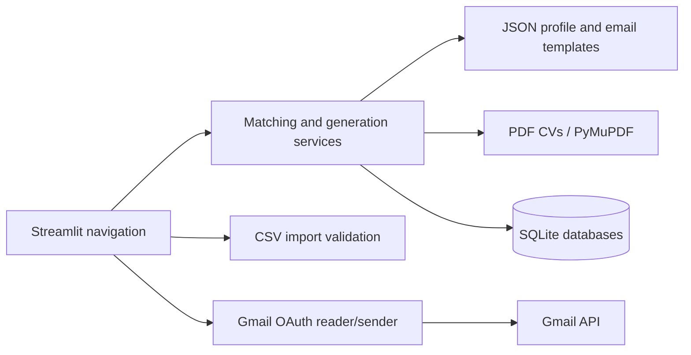
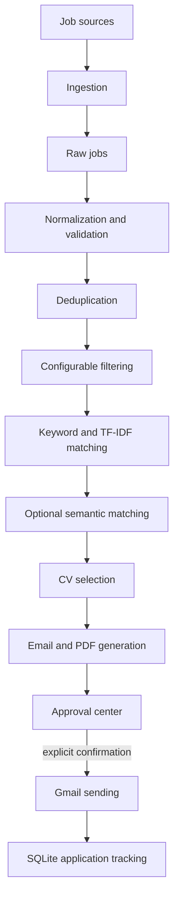

# PFE Copilot

PFE Copilot is a local Streamlit assistant for preparing and tracking final-year internship applications. It combines lexical job matching, profile-specific CV selection, editable French/English email drafts, motivation-letter PDF generation, CSV offer imports, optional Gmail OAuth, and SQLite tracking.

The matching engine is intentionally transparent: it normalizes the title and description, counts configured profile keywords from `config/profile.json`, and adds a small PFE signal. It is not TF-IDF, embeddings, or an AI ranking model.

## Implemented features

- Dashboard metrics and recent activity from SQLite.
- Job-offer analysis with detected profile, score, matched keywords, explanation, and CV recommendation.
- Four supported profiles: Data Engineer, Data Scientist, BI/Data Analyst, and AI Engineer.
- CV inventory, PDF validation, upload storage under `cvs/uploads/`, and PyMuPDF text extraction.
- Local French/English email templates with optional OpenAI-compatible generation when `OPENAI_API_KEY` is configured.
- Editable motivation letters and professional ReportLab PDFs with candidate/company/position/date metadata.
- CSV validation with required-column checks, preview, invalid-row and duplicate statistics, and matching/import into draft applications.
- Gmail offer retrieval through OAuth 2.0 with readable review before analysis.
- Spontaneous applications with CV and letter attachments, explicit confirmation before sending, and SQLite history.
- Searchable application tracking with status updates.

Gmail sending is never automatic. API keys, OAuth credentials, and tokens are read from local files/environment variables and are ignored by Git.

## Architecture



## End-to-end pipeline



The orchestrator persists jobs and stage tasks in SQLite and supports manual execution,
retrying temporary failures and rerunning individual failed jobs. The stages are:
`COLLECTED`, `NORMALIZED`, `VALIDATED`, `FILTERED`, `MATCHED`, `CV_SELECTED`,
`APPLICATION_GENERATED`, `PENDING_APPROVAL`, `SENT`, `TRACKED`, plus `REJECTED`,
`FAILED`, and `DUPLICATE`.

### Implemented ingestion

- Existing CSV ingestion, including the Streamlit CSV connector.
- RSS feeds through `RSSConnector`.
- Public career pages through `WebConnector` and BeautifulSoup.
- Existing Gmail offer reader.
- `robots.txt` checks for RSS and web connectors.
- Raw payload persistence and incremental processed-job storage.

Web scraping is intentionally limited to permitted public pages and does not bypass
authentication or CAPTCHA. Playwright is not required for pages that do not need
JavaScript rendering.

### Matching methodology

The baseline is explicitly non-semantic: normalized keyword matching and
TF-IDF/cosine similarity between an offer and each configured profile. An optional
Sentence Transformers implementation is available in `src/semantic_matching.py`;
if the model or library is unavailable, the system falls back to the local lexical
baseline. The UI reports the matching method, score, role, matched/missing skills,
and explanation.

### Database design

The existing `applications` table remains compatible. New SQLite tables include
`job_sources`, `raw_jobs`, `jobs`, `job_skills`, `candidate_profiles`,
`matching_results`, `application_documents`, `pipeline_runs`, `pipeline_tasks`,
and `email_logs`.

### Email safety

Gmail remains approval-first. Sending requires:

1. An explicit confirmation call from the UI.
2. A verified non-empty recipient.
3. An existing CV and generated motivation-letter PDF.
4. No existing successful send for the application.
5. Optional exact-recipient allowlisting with `EMAIL_RECIPIENT_ALLOWLIST`.

Set `AUTOMATED_SENDING_ENABLED=true` only to explicitly enable controlled
automation. The default is disabled.

```text
app.py
src/
  config.py                 # Central paths and environment configuration
  matcher.py               # Transparent lexical matching
  cv_selector.py            # CV selection, validation, extraction
  email_generator.py        # Local templates and optional AI endpoint
  cover_letter_generator.py # Letter text and ReportLab PDF
  job_sources.py            # CSV validation and deduplication
  database.py               # Application SQLite database
  spontaneous_database.py   # Spontaneous application SQLite database
  gmail_reader.py           # Gmail OAuth and offer retrieval
  gmail_sender.py           # Confirmed attachment sending
templates/
config/profile.json
cvs/
tests/
```

## Installation

```bash
python -m venv .venv
source .venv/bin/activate
python -m pip install -r requirements.txt
cp .env.example .env
streamlit run app.py
```

On Windows PowerShell, use `.venv\Scripts\Activate.ps1` and `Copy-Item .env.example .env`.

The application creates `data/pfe_copilot.db` and `data/spontaneous_applications.db` on first run.

## Configuration

`DATABASE_PATH` can override the main SQLite database path. Optional AI generation uses:

```text
OPENAI_API_KEY=...
OPENAI_BASE_URL=https://api.openai.com/v1
OPENAI_MODEL=gpt-4o-mini
```

For Gmail, create a Google Cloud OAuth Desktop client, enable Gmail API, and place the downloaded `credentials.json` at the repository root. The first Gmail action opens OAuth authorization and stores `token.json` locally. Never commit either file.

## Tests

```bash
python -m pytest -v
```

The tests cover matching, CV extraction and validation, email templates, PDF generation, CSV validation/deduplication, and SQLite persistence. Gmail API calls should be mocked in additional integration tests; no live Gmail credentials are required for the test suite.


