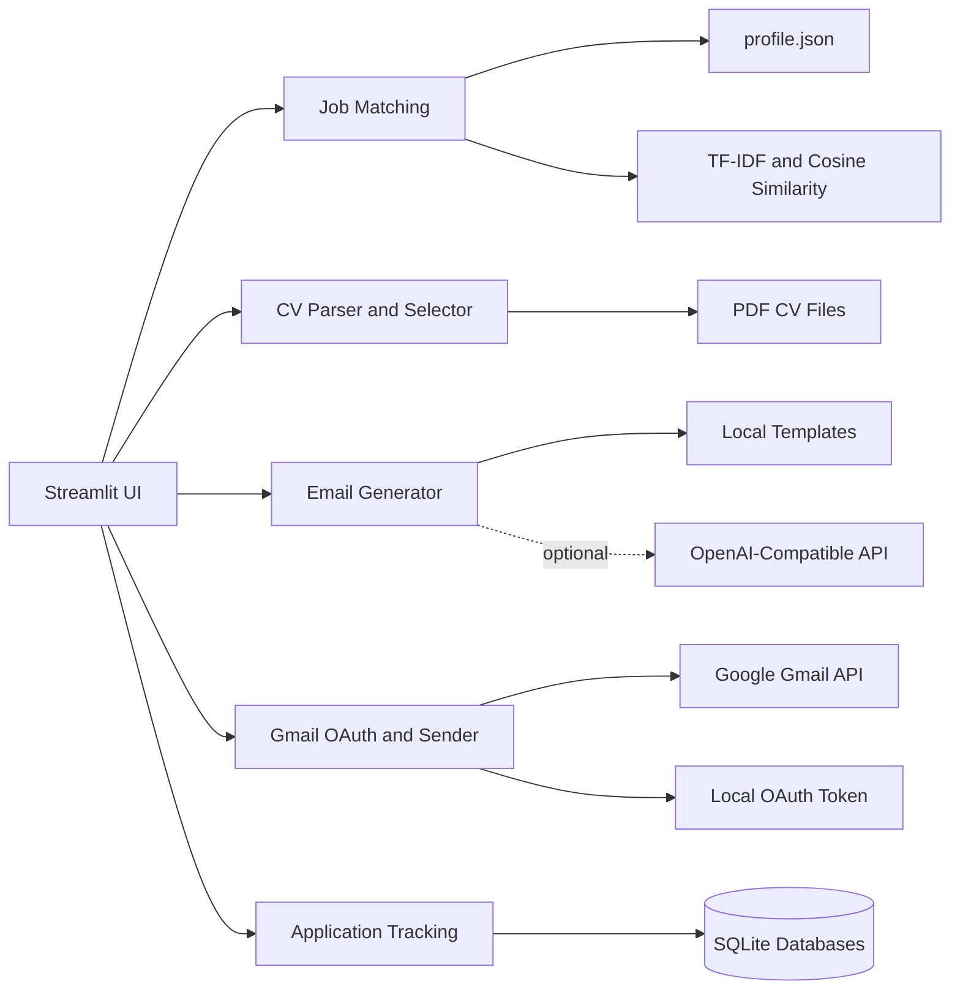

# PFE Copilot

PFE Copilot is a Python/Streamlit assistant for managing end-of-study internship applications. It centralizes opportunity discovery, explainable job matching, CV selection, application preparation, Gmail sending, and application tracking.

The project is designed for candidates in Big Data, Cloud Computing, Data Engineering, Data Science, AI/ML, and related fields.

## Main Features

- Manual opportunity entry and CSV import with SHA-256 deduplication
- Opportunity search, filtering, status tracking, and deadline fields
- Explainable 0-100 job matching using TF-IDF, cosine similarity, and profile keywords
- PDF CV text extraction and orientation-based CV recommendation
- French and English email generation
- Optional OpenAI-compatible API while keeping a local template fallback
- Spontaneous application workflow with mandatory HR email validation
- Gmail OAuth 2.0 with strict explicit confirmation before sending
- SQLite application tracking and dashboard metrics
- Human-in-the-loop email editing and attachment verification
- Gmail account verification and offer email retrieval

## Architecture



## Project Structure

```text
app.py                  Streamlit interface
config/profile.json     Candidate profile and role keywords
src/database.py         Opportunities and applications persistence
src/matcher.py          Explainable NLP matching
src/cv_parser.py        PDF text extraction
src/cv_selector.py      CV recommendations
src/email_generator.py  Local and optional LLM email generation
src/gmail_reader.py     Gmail OAuth and inbox reading
src/gmail_sender.py     MIME construction and Gmail sending
src/job_sources.py      CSV import and offer deduplication
src/spontaneous_database.py
tests/                  pytest unit and mocked integration tests
scripts/                Optional manual Gmail connection script
```

## Installation

```bash
python -m venv .venv
source .venv/bin/activate
pip install -r requirements.txt
cp .env.example .env
```

On Windows:

```powershell
python -m venv .venv
.venv\Scripts\Activate.ps1
pip install -r requirements.txt
Copy-Item .env.example .env
```

## Gmail OAuth Setup

1. Create a Google Cloud project and enable the Gmail API.
2. Configure an OAuth 2.0 client as a desktop application.
3. Download the client JSON as `credentials.json` in the project root.
4. Launch PFE Copilot and open **Gmail Settings**.
5. Confirm the local OAuth browser authorization.

The application requests only:

- `gmail.readonly`
- `gmail.send`

Never commit `credentials.json`, `token.json`, `.env`, personal CVs, or private database files. OAuth token storage and credentials paths can be changed with `GMAIL_CREDENTIALS_FILE` and `GMAIL_TOKEN_FILE`.

Gmail is never sent automatically. The application displays the recipient, subject, body, and attachments; sending requires a separate explicit checkbox and button action.

## Optional LLM

Email templates work without an API key. To use an OpenAI-compatible endpoint, set:

```env
LLM_API_URL=https://your-compatible-endpoint/v1/chat/completions
LLM_API_KEY=your-key
LLM_MODEL=gpt-4o-mini
```

If the API is unavailable or misconfigured, PFE Copilot falls back to the local template engine.

## Run

```bash
streamlit run app.py
```

Open the URL displayed by Streamlit, normally `http://localhost:8501`.

## Tests

```bash
pytest -q
```

The suite uses mocked Gmail services and does not require live credentials.

To manually inspect Gmail inbox retrieval after OAuth configuration:

```bash
python scripts/test_gmail_connection.py
```

## Data and Statuses

Opportunity statuses are:

- New
- Analyzed
- Interested
- Application prepared
- Applied
- Interview
- Rejected
- Accepted

Metrics are calculated from stored SQLite records. No fabricated dashboard values are used.

## Security Notes

- Credentials and tokens are excluded by `.gitignore`
- OAuth tokens are written with owner-only permissions when supported
- PDF uploads are limited to 10 MB and require a `.pdf` extension
- Recipient addresses are validated before sending
- CV existence is checked before constructing a Gmail message
- OAuth secrets and tokens are not displayed in the interface
- SQLite operations use parameterized queries

## Screenshots for a Public Portfolio

Suggested demonstrations:

1. Dashboard with real imported opportunities
2. Opportunity search and status management
3. Job matching score and explanations
4. CV recommendation
5. Editable English/French email preview
6. Spontaneous application confirmation screen
7. Gmail Settings OAuth status
8. Application tracking history

## Known Limitations

- Gmail inbox reading/import is credential-dependent
- CV upload saves locally; public CV data must be replaced or removed
- The LLM endpoint is optional and not bundled with a provider
- Matching is deterministic lexical/NLP scoring, not a trained ML model
- CSV import supports the documented column names

## License

No license is currently specified. Add a license before public redistribution if required.
